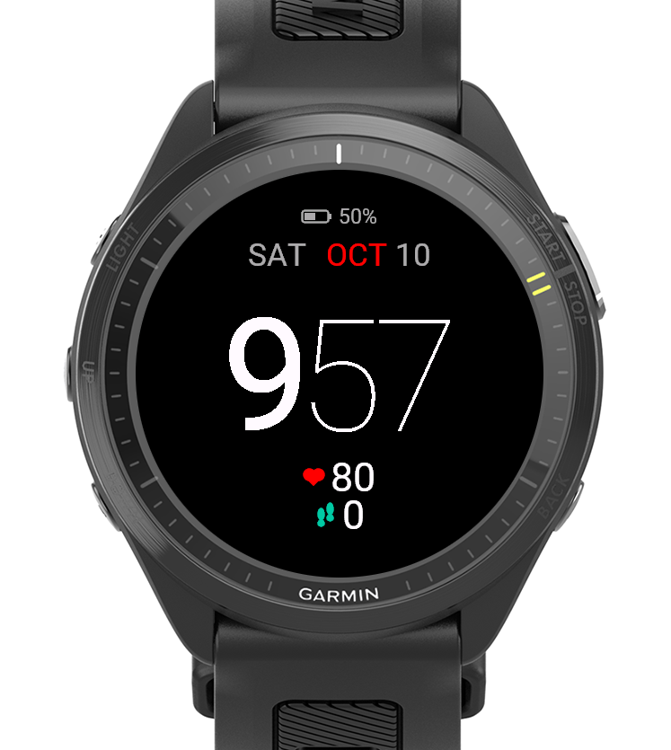

# Custom Garmin Watch Face

A minimal digital Connect IQ watch face for the Garmin Forerunner 970.

<p align="center"></p>

## Features
- Large time with no colon. Hours are in a regular weight and minutes in an extra-thin weight. It's 12-hour and centered by ink width.
- Battery level with a fill indicator.
- Weekday and date, with the month in red.
- Heart rate and daily steps.
- Always-on (AMOLED low-power) mode: the same layout in a dim palette, with a per-minute burn-in shift.

## Requirements
- Windows
- [Connect IQ SDK Manager](https://developer.garmin.com/connect-iq/sdk/), with an SDK set as current and the Forerunner 970 device downloaded
- Java 8+
- A developer key at `%USERPROFILE%\.connectiq\developer_key.der`:
  ```powershell
  openssl genrsa -out developer_key.pem 4096
  openssl pkcs8 -topk8 -inform PEM -outform DER -in developer_key.pem -out developer_key.der -nocrypt
  ```

## Build and run
```powershell
.\build.ps1        # outputs bin\WatchFace.prg
.\build.ps1 -Run   # also launches the simulator and loads the face
```

## Install on the watch
1. Connect the watch over USB.
2. Copy `bin\WatchFace.prg` to `Forerunner 970\Internal Storage\GARMIN\APPS`.
3. Eject the watch, then select the face on the watch.

## Fonts
The time digits are bitmap fonts generated from Roboto (SIL Open Font License, see `fonts-src/OFL.txt`) by `tools/gen_font.py`. Generating them requires Python and Pillow. The exact generator arguments are in `resources/fonts/fonts.xml`.
